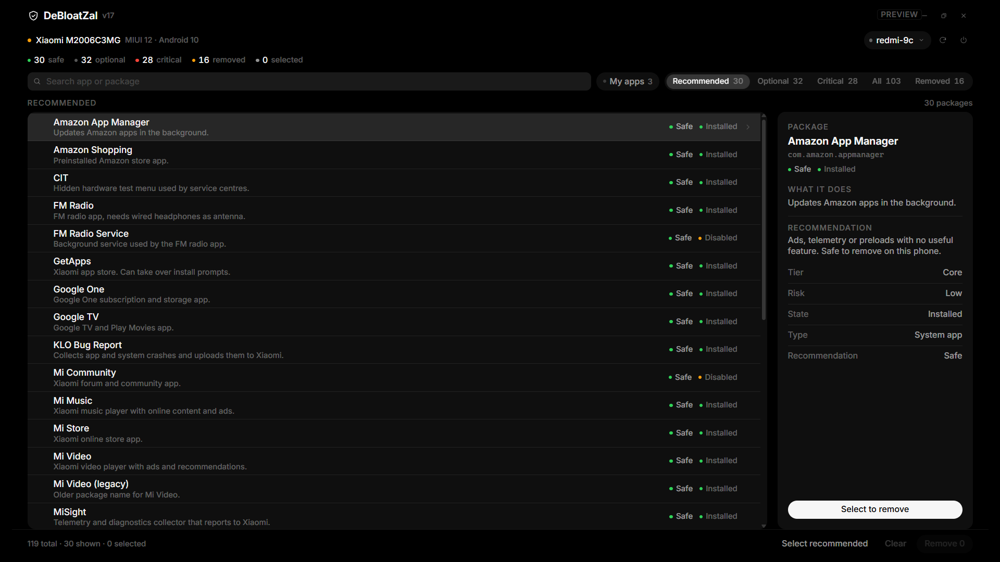
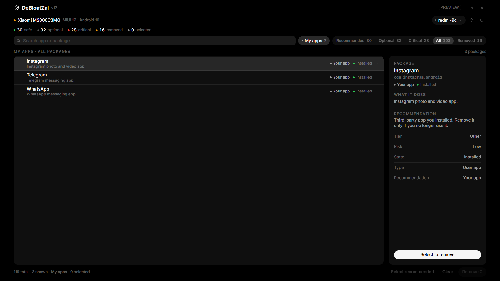
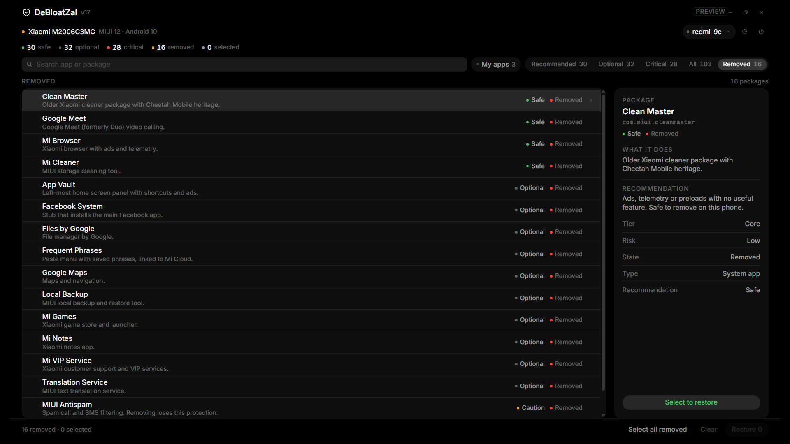

# DeBloatZal (USB only, no root)

Debloat these phones from a Windows laptop over a USB cable:

| Phone | Profile | Platform | Notes |
|---|---|---|---|
| Redmi 9C | `redmi-9c` | MIUI 12 / Android 10 | USB only (no wireless debugging on MIUI 12) |
| Redmi Note 8 | `redmi-note-8` | MIUI 11 / 12 / Android 9-11 | Note 8 / 8T / 8 Pro / 2021, USB only |
| Samsung Galaxy F22 | `samsung-f22` | One UI 3.x-5.x / Android 11-13 | 4G SM-F221 and 5G SM-E225F, USB only |

Everything is per-user (`--user 0`), reversible, and does **not** need root,
bootloader unlock, a custom ROM, or a factory reset.

**GUI:** double-click **`DeBloatZal.cmd`** for the DeBloatZal UI: pure
black, monochrome, grouped lists, 28px pills, a detail panel and one-click
restore.



The UI is HTML/CSS/JS in `gui\`, hosted by **WebView2** — the Edge engine that
already ships with Windows 10/11. The small .NET wrapper is bundled in
`gui\lib`, so there is nothing to install. Total GUI footprint is about **1 MB**
(no Electron, no Tauri, no Node). On first run WebView2 creates a ~9 MB cache in
`%LOCALAPPDATA%\DeBloatZalWebView2`.

---

## Do I need to install extra packages?

**No Python, no Node, no pip packages.** You need exactly two things:

1. **Android platform-tools (`adb`)** — `setup.ps1` downloads this automatically
   from Google into `.\tools\platform-tools`.
2. **A USB driver** — Windows 10/11 usually installs the generic ADB interface
   by itself.
   - Samsung F22 sometimes needs the official **Samsung USB Driver**:
     <https://developer.samsung.com/android-usb-driver>
   - Redmi 9C / Note 8 (MediaTek) normally work with the Windows-provided
     driver. MediaTek **VCOM** drivers are only for flashing tools
     (SP Flash Tool), not for `adb`.

If `adb` is already installed system-wide, the scripts will use it; the local
copy in `.\tools` takes priority. The GUI adds no install either: it uses the
WebView2 runtime that comes with Edge/Windows and the bundled wrapper in
`gui\lib`.

---

## Quick start

1. Double-click **`DeBloatZal.cmd`** (GUI) — or **`Start.cmd`** for the text menu.
   The old `Debloater.cmd` still works as an alias for existing shortcuts.
2. Enable USB debugging on the phone (below).
3. Plug in the USB cable, unlock the phone, tap **Allow** on the
   "Allow USB debugging?" prompt (tick *Always allow*).
4. Press **Refresh** — the phone, profile and package list load automatically.
5. Press **Select recommended**, review the detail panel, press **Remove N**, then reboot.

The `adb` download was already done by `setup.ps1`. If you ever move the folder
to a new PC, run **`Start.cmd` → 1** (or `.\setup.ps1`) first.

You can also run everything from PowerShell:

```powershell
.\setup.ps1
.\scripts\doctor.ps1
.\scripts\debloat.ps1 -DryRun                   # preview, changes nothing
.\scripts\debloat.ps1 -Tier core                 # interactive confirm
.\scripts\debloat.ps1 -Profile samsung-f22 -Tier all -Mode uninstall -Yes
.\scripts\restore.ps1                            # undo
```

> If PowerShell refuses to run the scripts, use `Start.cmd` (it already passes
> `-ExecutionPolicy Bypass`) or:
> `powershell -ExecutionPolicy Bypass -File .\scripts\debloat.ps1`

---

## Enabling USB debugging

### Redmi 9C and Redmi Note 8 (MIUI)

1. Settings → **About phone** → tap **MIUI version** 7 times.
2. Settings → **Additional settings** → **Developer options**.
3. Turn on **USB debugging**.
4. Recommended: also turn on **USB debugging (Security settings)** and
   **Install via USB**. MIUI may ask you to sign in to a Mi account, insert a
   SIM, and wait a few minutes before these two toggles stay enabled.
   They are needed when `pm uninstall` is rejected for system apps.
5. Plug in USB → choose **File transfer (MTP)** on the phone → tap **Allow**.

Notes:
- MIUI 12 has no wireless debugging screen, so USB is the only route — that is
  exactly what these scripts use.
- If the prompt never appears: Developer options → **Revoke USB debugging
  authorizations**, unplug, replug.
- Keep the phone unlocked while the script runs.

### Samsung Galaxy F22 (One UI)

1. Settings → **About phone** → **Software information** → tap **Build number**
   7 times.
2. Settings → **Developer options** → turn on **USB debugging**.
3. Plug in USB → choose **File transfer / Android Auto** → tap **Allow**.
4. If Windows does not see it, install the Samsung USB driver (link above) and
   replug. In Device Manager you want **Samsung Android ADB Interface** (or
   *SAMSUNG Mobile USB Composite Device*) without a warning triangle.

---

## GUI

Double-click `DeBloatZal.cmd` (or run `.\scripts\gui.ps1`).


The window is **pure black, edge-to-edge** — no purple, no gradients, no
dashboard cards. It follows the DeBloatZal house style: Inter, white-at-opacity
labels, grouped fill-1 surfaces, fine separators, 28px pills, and a full-width
white primary action.

**Header** — compact device line (model + OS), profile menu, refresh, reboot,
and **minimize / maximize / close**. The window opens maximized to fill
the screen; use the maximize button or double-click the titlebar to restore
the 1280px window. `-Windowed` starts windowed.

**Summary** — one compact line, not five cards. Click any item to jump to that
view:

| Item | Meaning |
|---|---|
| **Safe** | Core ads, telemetry and preloads (green) |
| **Optional** | Apps you may actually use (blue) |
| **Critical** | Locked system packages (red) |
| **Removed** | Currently uninstalled for user 0 (orange) |
| **Selected** | How many rows are ticked |

**Segments** — Recommended, Optional, Critical, All, Removed, each with a live
count and a sliding fill-3 pill.

**Rows** — a grouped list with app name, a one-line **what it does**
description, and recommendation/state as a small dot + label. Monochrome by
design: no colored icon tiles. Hover a row to preview it in the detail panel
(full description, why it is safe/caution/critical, tier, risk, state,
user/system). Clicking **anywhere on the row** ticks or unticks it.

**My apps** — the chip next to the search box filters to third-party apps you
installed yourself and shows their count. Turn it off to see Samsung/system
services again.

**Search** — global **app matching**, not keyword matching. It searches app
names and package ids only, across every package (installed, removed, system
and user), even while another segment is active. Type `facebook` and you get the
Facebook app **plus its variants** — Facebook App Manager, Facebook Services,
Facebook System and Messenger — because they share the `com.facebook` family.
Type `insta` and you get Instagram, not every package whose description says
“Installs …”. Results are ranked by app-name prefix, then package id. Press `/`
to focus, **Esc** or the **×** to clear. The small **ALL** chip shows the global
scope.

**Package count** — the footer’s “342 total” means every Android package:
system services, providers, overlays, Xiaomi/Google components, preloads and
your apps. It is not the number of app-drawer icons. The installed + removed
counts add up to that total.



**Actions**

- **Select recommended** — selects every recommended package (never Facebook;
  it is listed under Optional).
- **Remove N** — uninstalls after a confirmation. No snapshot, no change log.
- **Restore N** — reinstalls the ticked *removed* packages
  (`pm install-existing --user 0`). This is the only undo you need.
- After a removal the UI switches to **Removed** automatically, with the same
  packages still selected, so you can immediately restore them if something
  looks wrong.
- The footer only shows the action that fits what is selected — or the view
  when nothing is selected. Remove in the app views, Restore in Removed.
- Switching between the app views and Removed clears the selection, so you can
  never accidentally mix a removal and a restore.

Auto-detection covers the Xiaomi codenames (cattail/angelican and the Note 8
family ginkgo/biloba/willow/begonia) and both F22 variants
(`SM-F221` and `SM-E225F`). If nothing matches, the profile is left **blank**
instead of guessing — choose the right one in the profile menu.

No phone handy? **`DeBloatZal.cmd -Demo`** opens the same window with sample
Redmi 9C data. It cannot change anything. `-State removed` opens the Removed
view directly; `-UserOnly` starts in My apps; `-Windowed` starts in a 1280px
window instead of filling the screen; `-Search insta` opens with a global
search already filled in.



If WebView2 is unavailable, `scripts\gui-classic.ps1` is the older WinForms
window with the same engine.

---

## What the tiers mean

| Tier | Contents |
|---|---|
| `core` (default) | Ads/telemetry (MSA, analytics, Samsung DQA), Bixby/Game services, Facebook/Netflix/Spotify/Amazon/LinkedIn/Office preloads, duplicate system apps |
| `all` | `core` **plus** the `optional` list — YouTube, Maps, Gmail, Photos, browser, Gallery, Notes, Cloud, messaging, etc. |

The lists were cross-checked against the **UAD-NG** package database: Xiaomi and
Samsung packages UAD rates **Recommended** that were missing were added (Mi
Community, Mi Store, MiSight, Spock, OMC Agent, extra Bixby services, etc.).
Packages UAD rates **Advanced/Expert** — for example Device Health Services
(`com.google.android.apps.turbo`) — were deliberately kept out of `core`.

Review `profiles\*.profile` before using `all`. Every line is a package name;
comment a line with `#` to keep that app.

Modes (command-line scripts only — the GUI always uninstalls):

| Mode | What it does | Undo |
|---|---|---|
| `uninstall` (default) | `pm uninstall -k --user 0 <pkg>` — app disappears, data kept | `pm install-existing --user 0 <pkg>` |
| `disable` | `pm disable-user --user 0 <pkg>` — APK stays, app is turned off | `pm enable <pkg>` |

Both are **per-user 0** only: the system partition is never modified, so a
factory reset always brings everything back.

---

## Safety rules built into the tool

- A hard-coded critical list blocks SystemUI, Settings, the launcher, the
  package installer, telephony/telecom, Google Play services, Play Store,
  WebView, keyboards, the Samsung dialer/contacts/keyboard, MIUI Security, etc.
- Packages in a profile's `[protect]` section are always skipped.
- The command-line scripts write a full snapshot and a `*-changes.tsv` log to
  `.\logs`. The GUI writes nothing; the phone's own uninstalled state powers
  the Removed tab.
- `-DryRun` shows the plan without touching the phone.
- The tool aborts if the device is unauthorized, offline, or ambiguous
  (multiple phones connected — use `-Serial`).

Things to know:

- **Do not remove both** a system app and its replacement in the same run
  (e.g. Samsung Messages + Google Messages). Install the replacement first.
- Some packages cannot be restored with `pm install-existing` on certain MIUI
  builds. In the CLI, `disable` is the safer mode if you are unsure.
- OTA updates can reinstall some preloads; just re-run the profile.
- Removing Samsung Account / Galaxy Store / Knox core is out of scope on
  purpose: it breaks Secure Folder, Find My Mobile, backups, and updates.
- Use a data-capable cable and a rear USB port (no hub). Charge-only cables
  are the #1 cause of "no device found".

---

## Files

```
android-debloater/
├─ DeBloatZal.cmd              double-click: GUI
├─ Start.cmd                  double-click: text menu
├─ setup.ps1                  downloads platform-tools (adb) into .\tools
├─ README.md
├─ data/
│  └─ package-info.json       names, descriptions and risk for every package
├─ docs/
│  ├─ gui-preview.png
│  ├─ gui-removed.png
│  └─ gui-userapps.png
├─ gui/
│  ├─ index.html              the UI
│  ├─ style.css               DeBloatZal tokens and layout
│  ├─ app.js                  list, filters, detail panel, bridge
│  ├─ assets/                 Inter font + licence
│  └─ lib/                    bundled WebView2 wrapper (no install)
├─ profiles/
│  ├─ redmi-9c.profile
│  ├─ redmi-note-8.profile
│  └─ samsung-f22.profile
├─ scripts/
│  ├─ common.ps1              shared helpers, critical-package blocklist
│  ├─ gui.ps1                 WebView2 host (the current GUI)
│  ├─ gui-classic.ps1         old WinForms GUI (fallback)
│  ├─ menu.ps1                the menu behind Start.cmd
│  ├─ doctor.ps1              connection / driver / profile check
│  ├─ debloat.ps1             CLI debloater
│  ├─ list-packages.ps1       list packages + save snapshot
│  └─ restore.ps1             undo a change log
├─ logs/                      CLI snapshots and change logs (not the GUI)
├─ tools/
│  ├─ platform-tools/         adb.exe (created by setup.ps1)
│  └─ repair-usb.ps1          admin helper for stuck Samsung USB connections
```

Useful commands:

```powershell
.\scripts\list-packages.ps1 -Match 'miui|xiaomi'      # find a package
.\scripts\list-packages.ps1 -IncludeUninstalled       # include removed ones
.\scripts\debloat.ps1 -List -Profile redmi-9c         # show a profile
.\scripts\debloat.ps1 -Profile redmi-9c -Tier all -DryRun
.\scripts\restore.ps1 -All                            # restore everything ever changed
$env:ADB_PATH = 'C:\path\to\adb.exe'                  # force a specific adb binary
```

---

## Troubleshooting

| Symptom | Fix |
|---|---|
| `adb: no devices/emulators found` | USB debugging off, charge-only cable, wrong USB mode (use File transfer), or missing driver. Run `doctor.ps1`. |
| Device shows `unauthorized` | Unlock the phone and tap **Allow** (tick *Always allow*). Then Developer options → **Revoke USB debugging authorizations**, replug. |
| Device shows `offline` | Replug the cable, `adb kill-server`, try another port. |
| `more than one device` | Disconnect the others or pass `-Serial <serial>` (see `doctor.ps1` output). |
| MIUI: `Failure [DELETE_FAILED_INTERNAL_ERROR]` | Enable **USB debugging (Security settings)** and **Install via USB**, or use `-Mode disable`. |
| MIUI: `Failure [not installed for 0]` | Package is already removed for this user; nothing to do. |
| Samsung not detected at all | Install the Samsung USB driver, reboot Windows, use a rear USB 2.0 port. |
| App icon still visible after `disable` | Reboot, or use `-Mode uninstall` (recommended for a clean app drawer). |
| GUI lists nothing | Press **Refresh**; run `doctor.ps1` if the phone is not detected. Try `DeBloatZal.cmd -Demo` to confirm the UI itself works. |
| GUI picked the wrong profile | Choose the right one in the profile menu (top right). If nothing matched, the profile is left blank on purpose. |
| GUI Remove does nothing | Tick at least one row with state `installed`; protected/removed rows cannot be removed. |
| GUI is blank / does not open | The UI needs the Edge WebView2 runtime (normally already installed). If it opens a message about WebView2, run `scripts\gui-classic.ps1` — the old window with the same engine. |
| Removed app not listed | Click **Removed** in the segment bar. Apps removed outside this tool may not be restorable with `pm install-existing`. |
| Phone only charges / Windows sees nothing | Run **`tools\repair-usb.ps1`** as administrator (removes stale Samsung USB nodes and disables USB selective suspend), reboot, then replug. If it still shows nothing, try another A-to-C data cable/port. |
| Something broke (launcher/UI missing) | Run `restore.ps1`, pick the newest log, reboot. Worst case: factory reset (system partition was never modified). |
| `running scripts is disabled on this system` | Use `Start.cmd`, or `powershell -ExecutionPolicy Bypass -File ...`. |

### Verify on the phone

After a run you can confirm results without the laptop:

- Settings → Apps → see the app is gone / disabled.
- The app drawer no longer shows the preloads.
- Battery/background data screens are noticeably quieter.

---

## Scope / disclaimer

This only changes **user 0** app state through the official Android `pm`
command. It does not root, flash, unlock, or modify `/system`. You are still
responsible for what you remove: read the `optional` list, keep a restore log,
and reboot/test after each session.
